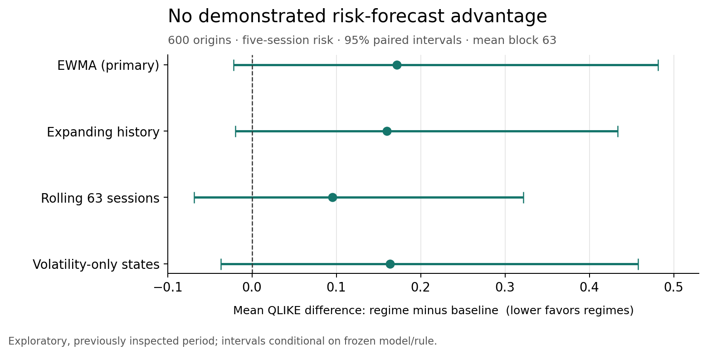

<p align="center">
  
</p>

# Wasserstein Regimes

Wasserstein Regimes clusters trailing windows of daily log returns. Each window is one empirical distribution. The research question is whether using every return in the window changes the market states identified by volatility, moments or covariance alone.

In the SPY study, differences in scale accounted for **97.87%** of the total squared W2 distance across pairs of fitted cluster centers. In a separate five-ETF study, forecasts based on the joint market state had higher average loss than all four risk baselines. [SPY results](docs/research-results.md) · [Risk forecast results](docs/risk-results.md)

## Methods

For one asset, sort the equally weighted returns in two windows of the same length. Let `x` and `y` be the sorted arrays. Each estimator uses all order statistics.

| Metric | Distance and fitting objective | Cluster center |
| --- | --- | --- |
| W1 | `W1 = mean(abs(x - y))`. Minimize the sum of W1 distances. | Median across member windows at each rank |
| W2 | `W2² = mean((x - y)²)`. Minimize the sum of squared W2 distances. | Mean across member windows at each rank |

For multiple assets, each observation is a vector of returns over the same trading session. The joint estimator uses sliced W2. It projects the vectors onto fixed directions and averages the squared one-dimensional W2 distances across those directions. It selects **medoids**, observed training windows that serve as cluster centers, from a sample of candidates. The five-ETF study used 64 directions and 128 candidates per restart. Both estimators give the same distance after any reordering of observations within a window, provided each joint return vector stays intact. [Methods](docs/methods.md) · [Joint market protocol](docs/joint-market-protocol.md)

## Empirical results

The ETF studies use 63-session windows. The joint model estimates asset scales on training returns through 2020 and selects the number of clusters on 2021–2023 validation data. Each assessment window uses prices strictly after the validation cutoff, including the price needed to compute its first return. The adjusted-close histories contain provider revisions, and earlier studies had already examined the 2024–August 2026 period used for the joint market and risk assessments. Both assessments are exploratory.

The adjusted Rand index (ARI) measures how often two partitions group the same windows together, adjusted for chance. A value of 1 indicates identical partitions up to relabeling. Market windows have no observed regime labels.

| Study | Result |
| --- | --- |
| [SPY](docs/research-results.md) | Holdout assignments from W2 and volatility-only clustering had ARI **0.990**. Two of three W2 states occurred in the holdout. |
| [QQQ, TLT, GLD and HYG](docs/cross-asset-results.md) | Scale accounted for **95.27–97.53%** of squared W2 separation between fitted centers. TLT and HYG each occupied a single holdout state. |
| [Joint synthetic controls](docs/joint-results.md) | On two synthetic distributions with identical marginals and covariance but opposite signs for the product of three coordinates, sliced W2 recovered the labels with ARI **1.000** in all nine runs. |
| [Five-ETF panel](docs/joint-market-results.md) | Six models scored the same **605** assessment windows. The scaled joint model assigned **495** windows to one state, **110** to another and zero to the third. |
| [Robustness](docs/joint-validation-results.md) | Across 30 refits on resampled blocks of training returns, mean validation ARI against the original fit was **0.518**. Adding extreme shocks to 1% of training return vectors put every clean validation window in one state. |
| [Frozen model scoring](docs/execution-results.md) | Reloading the saved model reproduced all **690** validation labels. A second run of the 11-job batch reused all 11 verified results. |

### Five-session risk forecast

The target was the average daily squared simple return over the next five sessions for an equal-weight, daily-rebalanced basket of SPY, QQQ, TLT, GLD and HYG. This estimates the conditional second moment, which equals variance when the conditional mean is zero. The model updated each state's risk estimate only after all five returns for a past forecast were available.

The primary loss was QLIKE, computed as `log(f) + y/f` for forecast `f` and observed target `y`. Lower values indicate better forecasts. Across **600** scored forecasts, expanding history, an exponentially weighted moving average (EWMA), a 63-session rolling average and volatility-only states all had lower mean loss than the joint model. The mean difference in loss (joint model minus EWMA) was **+0.1715**. The paired 95% block-bootstrap interval **[−0.0217, +0.4816]** includes zero and conditions on the selected model. [Frozen forecast protocol](docs/risk-protocol.md) · [Losses and intervals](docs/risk-results.md)



## Run the estimators

The estimators require Python 3.11+ and NumPy. The bundled example fits two clusters to simulated returns with alternating volatility and prints the objective and cluster sizes.

```bash
git clone https://github.com/kenchengkc/wasserstein-regimes.git
cd wasserstein-regimes
python3 -m venv .venv
source .venv/bin/activate
python -m pip install -e .
python examples/synthetic.py
```

For a single asset, pass an array of shape `(windows, returns)`. Here each row contains 63 synthetic returns. `predict` returns one cluster label per window. `transform` returns its distance to each fitted center.

```python
import numpy as np
from wasserstein_regimes import WassersteinKMeans

rng = np.random.default_rng(42)
train = np.vstack([
    rng.normal(0, 0.005, size=(100, 63)),
    rng.normal(0, 0.020, size=(100, 63)),
])
test = rng.normal(0, 0.010, size=(5, 63))

model = WassersteinKMeans(metric="w2", n_clusters=2, random_state=42).fit(train)
labels = model.predict(test)          # (5,)
distances = model.transform(test)     # (5, 2), in W2 units
```

For joint estimation, add an asset axis and keep assets in the same order at prediction time. This example fits windows from two processes with the same marginal volatilities and different correlations.

```python
import numpy as np
from wasserstein_regimes import SlicedWassersteinKMedoids

rng = np.random.default_rng(42)
positive = [[1, 0.8], [0.8, 1]]
negative = [[1, -0.8], [-0.8, 1]]
train = np.concatenate([
    rng.multivariate_normal([0, 0], cov, size=(60, 63))
    for cov in (positive, negative)
])
test = rng.multivariate_normal([0, 0], negative, size=(5, 63))

model = SlicedWassersteinKMedoids(
    n_clusters=2, n_projections=32, candidate_size=32, random_state=42,
).fit(train)
labels = model.predict(test)
```

## Reproduce the studies

The repository contains [study configurations](configs/), [aggregate results and checksums](results/) and [numerical tests](tests/). Exact market reruns require the recorded Yahoo Finance adjusted-close snapshots, acquired with yfinance, and compatible code and dependency versions. Prices, fitted market medoids and per-window assignments stay local. A fresh download can contain revised prices and produce a different snapshot hash. [Data sources and acquisition](docs/data.md)

To install the research dependencies and run the tests from the repository root, use the active virtual environment. The requirements file pins the direct dependencies tested with Python 3.11.

```bash
python -m pip install -r requirements-research.txt
python -m pip install -e '.[research,dev,data]'
export VECLIB_MAXIMUM_THREADS=1
python -m pytest
```

The batch commands below run on Linux or macOS after the matching snapshots, development artifacts and frozen model bundle are in the paths specified by the configs. Repeating a job verifies and reuses its completed outputs. [Univariate workflow](docs/research-workflow.md) · [Robustness protocol](docs/joint-validation-protocol.md) · [Frozen scoring and jobs](docs/execution-workflow.md) · [Risk workflow](docs/risk-workflow.md)

```bash
regimes run-jobs --config configs/execution.yaml --workers 2 --blas-threads 1
regimes run-jobs --config configs/risk_jobs.yaml --workers 1 --blas-threads 1
```

The documentation site includes the study protocols, worked results and open research questions. Preview it locally with `python -m pip install -r requirements-docs.txt` and `python -m mkdocs serve`. [Documentation](https://wasserstein-regimes.vercel.app/) · [Research agenda](docs/research-roadmap.md)

## Reference and license

Horvath, Issa and Muguruza studied hourly SPY returns. This repository adapts their distributional clustering method to daily returns and extends it to synchronized multi-asset windows. [Motivating paper](https://arxiv.org/abs/2110.11848v1) · [Methodological differences](docs/paper-review.md)

The original code and documentation use the GNU General Public License, version 3 only (`GPL-3.0-only`). Third-party data and papers have their own terms. [License](LICENSE)
